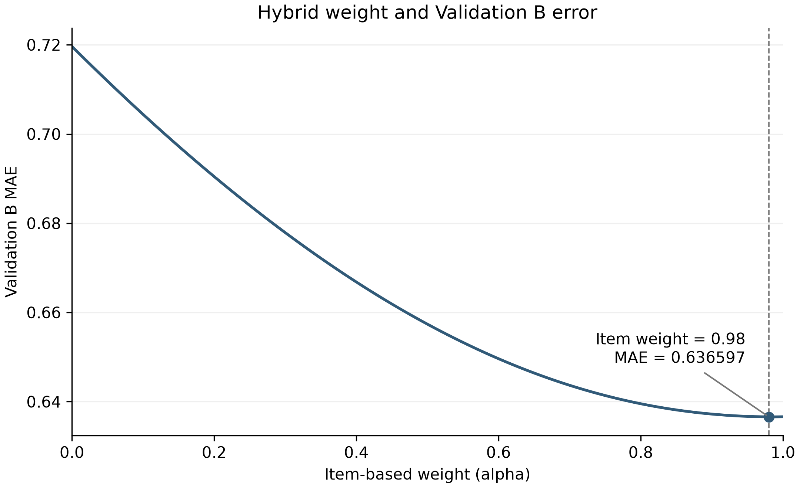
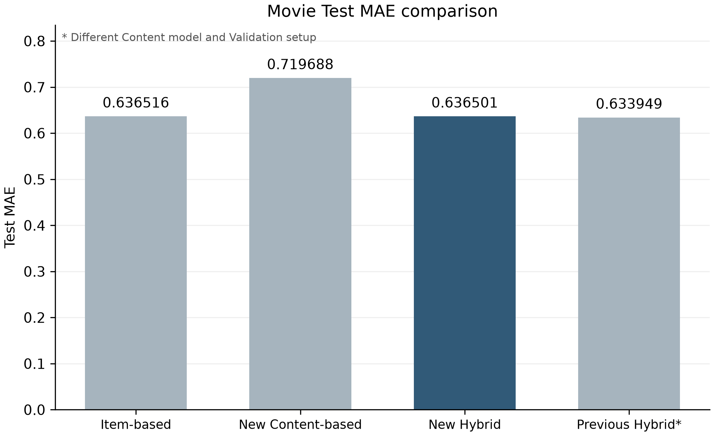
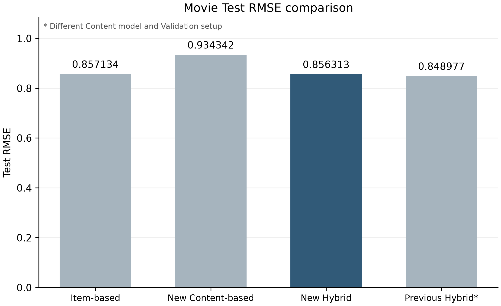

# 영화 Hybrid 추천시스템 최종 실험

## 실험 목적과 데이터

Item-based와 Content-based의 예측을 결합하여 단독 모델보다 평점 예측 오차를 줄일 수 있는지 확인하였다. MovieLens 32M 중 기존 공통 전처리 데이터를 사용하였다. 기존 Validation을 `numpy.random.default_rng(42)`로 섞어 A/B로 나누었다.

| 분할 | 평점 수 | 용도 |
|---|---:|---|
| Train | 17,401,383 | Item-based 학습, 사용자 평균과 선호 프로필 |
| Validation A | 1,087,586 | Item-based K 선택, Content-based 회귀 학습 |
| Validation B | 1,087,587 | Hybrid 결합 비중 선택 |
| Test | 2,175,173 | 고정된 모델과 비중의 최종 평가 |

회귀 학습에 사용한 정답과 결합 비중을 고르는 정답을 분리하였다. Test는 학습이나 비중 선택에 사용하지 않았다.

## 모델 구성

Item-based는 사용자 평점 패턴의 코사인 유사도를 사용하는 Item-based CF이다. Validation A에서 K=20, 30, 50을 비교하여 K=50을 선택하였다. 유효한 이웃이 없으면 기존 평균 기반 대체 예측을 사용하였다.

Content-based는 사용자 Train 평균에 비음수 Ridge가 예측한 잔차를 더한다. 입력은 장르 유사도, 정규화한 사용자·영화 줄거리 임베딩의 원소곱 1,024개, 러닝타임과 연도 근접도로 총 1,027개이다. Ridge alpha는 10이며 회귀 계수는 비음수로 제한하고 절편은 제한하지 않았다. 팀원 코드의 학습·피처·예측 함수를 그대로 사용하였다. 예측 평점은 기존 구현대로 0.5~5점으로 제한하였다.

Hybrid는 `alpha × Item-based + (1-alpha) × Content-based`로 계산하였다.

## 데이터 불일치와 재실행

기존 Content-based Validation B CSV에는 공통 Validation A 272,726행, B 271,777행, Test 543,084행이 포함되어 있었다. CSV 생성 당시 원본 데이터나 실행 버전이 달랐는지는 확인하지 못했으므로 원인을 확정하지 않았다.

잘못된 CSV에서 일부 행을 추출하지 않고 원본 SHA-256과 공통 인덱스를 검증한 뒤 Validation A로 다시 학습하였다. 새 Validation B와 Test CSV는 Item-based와 전체 사용자·영화 ID, 정답 및 행 순서가 일치하였다. 중복, 예측 범위, 저장 후 재로딩 검증도 통과하였다.

## 가중치 선택

Validation B에서 alpha=0.00~1.00을 0.01 간격으로 비교하였다. 총 101개 조합 중 MAE가 낮은 값을 우선하고, 동률이면 RMSE와 작은 alpha 순으로 선택하였다. 저장된 결과의 최적 비중은 Item-based 0.98, Content-based 0.02이다. 해당 Validation B MAE는 0.636597, RMSE는 0.856503이다.



## 최종 Test 결과

| 모델 | Test MAE | Test RMSE | Item 대비 MAE 차이 | Item 대비 RMSE 차이 |
|---|---:|---:|---:|---:|
| Item-based | 0.636516 | 0.857134 | +0.000000 | +0.000000 |
| 새 Content-based | 0.719688 | 0.934342 | +0.083172 | +0.077209 |
| 새 Hybrid | 0.636501 | 0.856313 | -0.000015 | -0.000820 |
| 기존 Hybrid (구성 다름) | 0.633949 | 0.848977 | -0.002567 | -0.008156 |

차이는 해당 모델의 오차에서 Item-based 오차를 뺀 값이며, 음수는 오차 감소이다. CSV의 원래 정밀도로 차이를 계산하고 표에서만 소수점 여섯 자리로 표시하였다. 기존 Hybrid는 전체 Validation에서 비중을 선택한 SharedContentCF 기반 실험이므로 동일 조건 비교가 아니다.





새 Hybrid는 Item-based보다 MAE가 0.000015, RMSE가 0.000820 낮았다. 특히 MAE 개선 폭은 매우 작으며, 선택된 Content-based 비중도 2%이다. 기존 Hybrid보다 MAE는 0.002552, RMSE는 0.007336 높았다. Content-based 구현과 Validation 구성이 함께 달라 이 차이를 Content-based 모델 하나의 영향으로 단정할 수 없다.

## 한계

기존 Hybrid와 같은 조건에서 변경 요인별 영향을 분리한 실험은 수행하지 않았다. 프로필 생성 코드는 Train 평점을 사용하며, 저장된 장르·수치 프로필 전체와 줄거리 프로필 128명을 Train 계산값과 비교하였다. 다만 줄거리 프로필 전체와 과거 생성 이력까지 검증한 것은 아니다. 기존 콘텐츠 전처리 기준은 그대로 사용하였다. 이번 결과는 영화 Test 성능이며, 향후 동일 조건 비교와 다른 도메인 평가가 필요하다.

## 실행과 공유

경로는 저장소 루트를 기준으로 한다. `requirements-item-based.txt`의 NumPy, pandas, SciPy, scikit-learn, Matplotlib, psutil이 필요하다. 공통 예측 함수를 가져오는 과정에서 `run_full_recsys_pipeline.py`, `src/item_based.py`, `src/content_based.py`, `src/common_item_data.py`, `src/transfer_data.py`, `src/processed_validation.py`, `src/hybrid.py`도 필요하다.

1. 동일한 `movie_item_user_data.npz`, `movie_user_profiles.npz`, `movie_content.npz`와 공통 A/B NPZ·인덱스·`split_info.json`을 준비한다. 원본 파일별 SHA-256은 `results/content_based/hybrid_local_rebuild/rebuild_info.json`에 기록되어 있다.
2. 분할 파일이 없는 경우에만 `python -B scripts/split_hybrid_validation.py`로 생성한다. Item-based 결과가 없으면 `run_item_validation_a.py`, `run_item_validation_b_test.py` 순으로 실행한다. 기존 결과 폴더가 있으면 덮어쓰지 않고 중단한다.
3. Content-based 구현은 Git blob `7b2eb0c306e64a8aff6935a99b03109ff2d40b07`에서 읽는다. 해당 객체가 없는 저장소에서는 팀원 원본 `cross_domain_eval_usermean_plot_ridge.py`를 별도로 준비하여 아래처럼 지정한다. 소스 SHA-256이 실험 버전과 다르면 중단한다. 팀원 원본 코드를 수정하거나 현재 브랜치를 바꿀 필요는 없다.

```text
python -B scripts/run_content_hybrid_local.py --team-source <팀원_원본_코드.py> --content-output results/content_based/reproduction_new --hybrid-output results/hybrid/reproduction_new
```

이 명령은 Content-based 학습부터 Hybrid 평가까지 수행하므로 새 출력 폴더를 지정해야 한다. 이번 산출물 정리에서는 실행하지 않았다. `run_updated_hybrid.py`의 구형 CLI는 잘못된 분할의 CSV를 사용하지 않도록 비활성화하였다. 직접 실행하면 최종 실행기를 안내하고 종료하며, 검증 함수는 로컬 실행 파일에서 그대로 재사용한다.

저장된 결과를 시각화하는 명령은 `python -B scripts/plot_updated_hybrid_results.py`이다. 학습·예측·지표 재평가 없이 결과 CSV/JSON만 읽는다. 그래프와 비교표가 이미 있으면 덮어쓰지 않고 중단한다. 원래 실험의 그래프를 새로 만들려면 입력 결과 세 파일을 새 폴더에 복사하고 `--results-dir <새_폴더>`로 지정한다. 원 실험의 출처 JSON 및 기존 성능 CSV도 저장소의 원래 경로에 필요하다.

소형 결과 파일만 내려받아도 표와 그래프는 확인할 수 있다. 원본 NPZ와 대용량 예측 CSV가 없으면 모델 재현이나 예측 기반 재평가는 할 수 없으며, 데이터를 준비하고 예측을 생성해야 한다. 이번에는 의존 모듈과 팀원 소스 로딩만 확인했으며, 새 경로 옵션으로 전체 학습을 다시 실행하지 않았다.

업로드 대상은 실행 스크립트, 소형 결과 JSON/CSV, 이 보고서와 PNG 세 개이다. 분할·Item-based 실행 스크립트와 위 의존 모듈도 저장소에 있어야 한다. 대용량 예측 CSV, 원본·분할 NPZ, 가상환경은 업로드에서 제외한다. 현재 `.gitignore`는 `data/raw/`, 가상환경, 캐시 등을 제외하지만 `data/processed/`와 결과 CSV 전체를 자동으로 제외하지 않으므로 SourceTree에서 파일을 개별 선택해야 한다. `.gitignore`와 스테이지는 변경하지 않았다.
