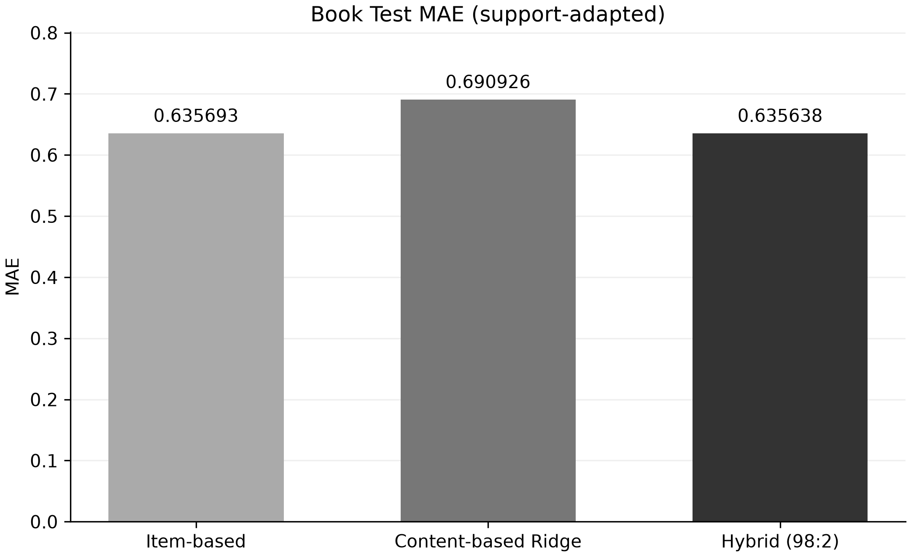
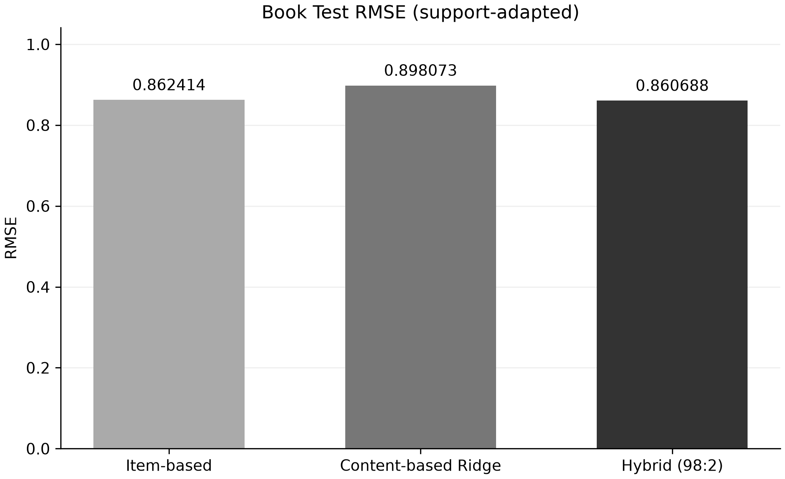
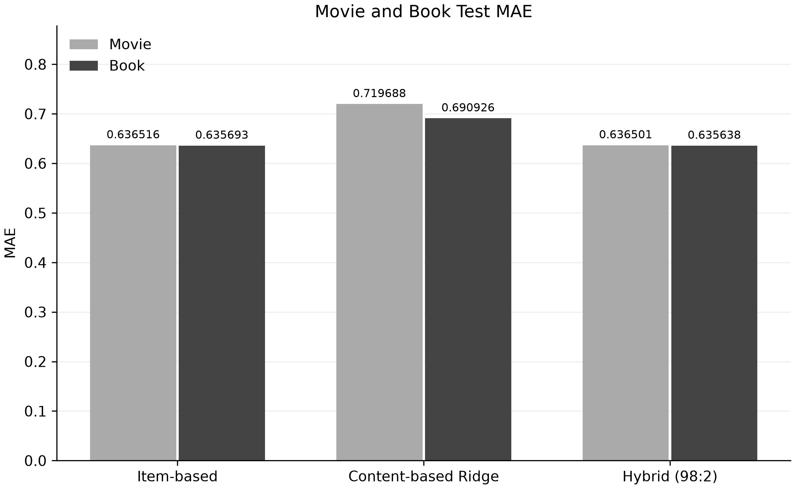
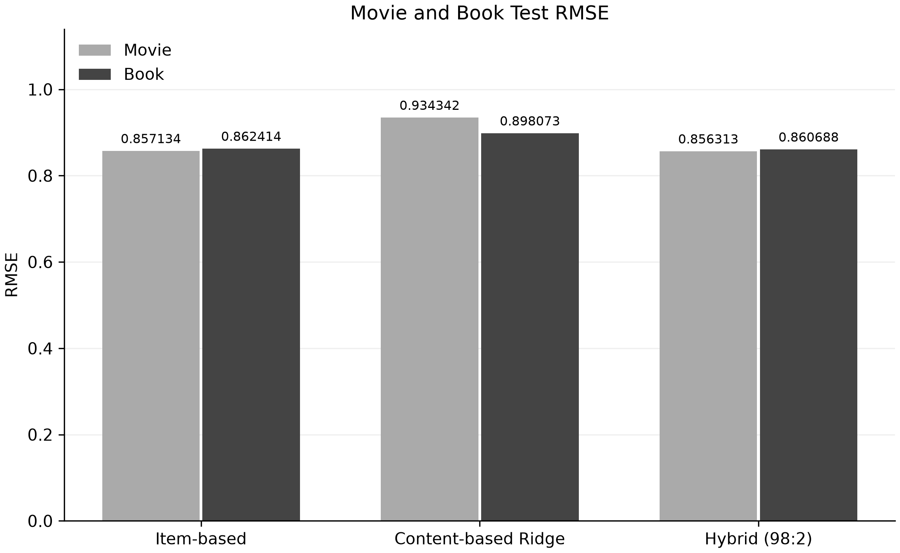

# Hybrid 추천시스템의 도서 평가

## 1. 실험 목적

영화 데이터로 개발한 새로운 Hybrid 모델을 Goodbooks 도서 데이터에도 적용하여 성능을 확인하였다. Item-based와 Content-based를 결합했을 때 단독 모델보다 평점 예측 오차가 줄어드는지 비교하였다. 이번 실험은 기존 SharedContentCF 기반의 85:15 도서 Hybrid와 별개이다.

## 2. 실험 방법

영화 Validation을 Seed 42로 A/B로 나누었다. Validation A에서 Item-based의 K를 선택하고 Content-based Ridge를 학습한 뒤, Validation B에서 Hybrid 결합 비중을 결정하였다.

| 설정 | 적용 내용 |
|---|---|
| Item-based | K=50 |
| Content-based | 비음수 Ridge, alpha=10, 절편은 제약 없음 |
| Hybrid | Item-based 98% + Content-based 2% |
| Book Train | 4,781,183건, 도서 유사도와 사용자 평균·선호 프로필 구성 |
| Book Test | 597,648건, 세 모델을 동일한 평점 기록으로 평가 |

저장된 영화 모델 객체가 없어 같은 영화 Train 프로필과 Validation A로 Ridge를 다시 학습하였다. 도서 예측에서는 이 회귀 계수를 그대로 유지하였다. Book Validation이나 Test로 K, 회귀 계수, 결합 가중치를 다시 선택하지 않았다. 도서 예측 평점은 1~5점으로 제한하였다.

## 3. 평가 결과

MAE와 RMSE는 낮을수록 좋다. 영화 결과는 기존 검증값을 사용하고, 도서 결과는 이번 Book Test 평가값을 사용하였다.

| Model | Movie MAE | Movie RMSE | Book MAE | Book RMSE |
|---|---:|---:|---:|---:|
| Item-based | 0.636516 | 0.857134 | 0.635693 | 0.862414 |
| Content-based | 0.719688 | 0.934342 | 0.690926 | 0.898073 |
| Hybrid (98:2) | 0.636501 | 0.856313 | 0.635638 | 0.860688 |









## 4. 결과 분석

영화와 도서 모두 Hybrid가 Item-based 단독보다 MAE와 RMSE에서 소폭 낮은 오차를 보였다. 도서에서는 MAE가 0.000055, RMSE가 0.001726 감소하였다. 다만 차이가 매우 작으므로 큰 성능 개선으로 해석하기는 어렵다.

영화 Validation B에서 선택된 Content-based 비중은 2%이다. 이번 결과는 Item-based 예측에 Content-based를 조금 반영했을 때 오차가 줄어든 사례이며, 다른 데이터에서도 같은 효과가 나타난다고 단정할 수는 없다.

## 5. 한계

Book Train으로 책 간 유사도와 사용자 프로필을 구성했으므로 완전한 Zero-shot Transfer가 아니라 Support-adapted 평가이다. 영화와 도서는 사용자, 아이템, 평점 분포가 다르므로 두 데이터셋의 오차 수치만으로 전이 성능의 우열을 판단할 수 없다.

영화 상영시간과 도서 페이지 수는 서로 다른 특징이다. 이번에는 각 도메인에서 정규화한 길이 선호 근접도를 사용했지만, 그 영향이 두 도메인에서 같다고 보장할 수는 없다. 기존 전처리도 영화와 도서의 장르·연도 기준을 함께 구성했으므로 모든 변환을 영화만으로 학습한 실험은 아니다. 임베딩 생성 이력과 사용자 프로필 전체를 완전히 검증하지 못한 한계도 있다.

실행은 저장소 루트에서 다음 순서로 진행한다.

```text
python -B scripts/run_book_hybrid_eval.py
python -B scripts/plot_book_hybrid_results.py
```

동일한 원본 NPZ·공통 분할 파일과 기존 영화 설정·결과 파일이 필요하다. 팀원 소스 Git 객체가 없으면 평가 실행에 `--team-source <원본.py>`를 지정한다. 기존 출력이 있으면 실행이 중단되므로 재실행할 때는 새 폴더를 `--output-dir`과 `--results-dir`에 동일하게 지정한다.

상세 설정, 입력 해시와 검증 결과는 [book_eval_info.json](book_eval_info.json)을 참고한다.
